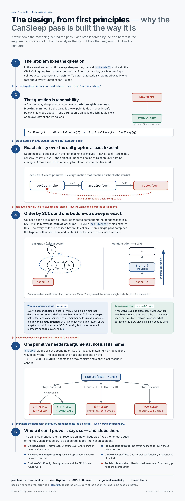

# Design notes

This document records the analysis design of the Sleepability pass, why it is
correct, and the decisions behind its scope. It is precise about what is and is
not claimed. Version 0.2.0.

The pass is the C side of **CLSC, the Context-Lattice Sleepability Checker**:
it derives, for each C function, a summary of whether it may sleep. The Rust
side (the atomic-context typestate) and the call-site join are in the companion
repository [`guardstate`](https://github.com/AnnanyaSood1/guardstate), which
reads the summary file this pass writes.

The one-page figure below explains version 0.1. Steps 1 to 4 still hold. Steps
5 and 6 are superseded by the sections on conditional summaries and on indirect
calls below: unknown flags no longer default to MAY SLEEP, indirect calls are
no longer skipped, and SCCs are now iterated internally.



## 1. Problem

In the Linux kernel some functions **may sleep**: they can call `schedule()`
and give up the CPU. Calling a may-sleep function in **atomic context** (with a
spinlock held, in an interrupt handler, in an RCU read-side section) is a bug
that can hang the machine. Whether a call site is safe depends on two facts:
the *context* it runs in, and whether the *callee* may sleep.

In Rust-for-Linux the two facts live in different languages. The context is
set by a Rust lock guard; the callee is C, reached through a `rust_helper_*`
shim or a direct `extern "C"` declaration. This pass computes the second fact
for C code, as a per-function summary over LLVM IR.

## 2. The summary lattice

Each function gets one summary, built from four facts and joined monotonically:

| Class | Meaning |
| --- | --- |
| `ATOMIC-SAFE` | no path reaches a blocking primitive |
| `IF-FLAGS` (arg *i*) | may sleep **iff** argument *i* carries the gfp direct-reclaim bit |
| `UNKNOWN` | reaches a call the pass cannot resolve (a function pointer) |
| `MAY SLEEP` | some path reaches a blocking primitive, whatever the arguments |

Internally a summary is a triple: a may-sleep bit, an unknown bit, and a set of
argument indices. The join is "or" on the bits and union on the set, so the
summaries form a finite lattice of finite height, and the transfer below is
monotone. The printed class is the strongest fact: MAY SLEEP, else UNKNOWN,
else IF-FLAGS, else ATOMIC-SAFE.

`IF-FLAGS` is the parametric summary of the research plan. Without it, every
wrapper that forwards its caller's flags (as `rust/helpers/slab.c` does in
Linux 6.18) would have to be reported as always sleeping, and every Rust
allocation under a spinlock would be flagged, including `GFP_ATOMIC` ones.

## 3. Ground truth: the primitive table

Facts originate at primitives, matched by symbol name:

- **Unconditional sleepers**: built in are `mutex_lock`, `schedule`, `msleep`,
  `might_sleep`.
- **Allocators** with a flags argument: built in is `kmalloc` (flags at
  argument 1).

`-sleepability-primitives=FILE` extends the table with lines `sleep NAME` and
`gfp NAME ARGINDEX`. The built-in list is enough for the test suite and far too
small for a real kernel: on the Linux 6.18 helpers it finds 2 sleeping helpers
out of 341, against 20 with `config/linux-6.18.primitives` (see
`results/linux-6.18/README.md`). The table is per kernel version, because the
allocator entry points change names (`kmalloc` is an inline wrapper; the
helpers call `krealloc_node_align_noprof`).

**What is deliberately not a sleeper.** Involuntary preemption is not a
voluntary sleep. `spin_unlock` re-enables preemption and may call
`preempt_schedule` if a reschedule is pending, but that is the scheduler
preempting the task, which is allowed; it is not a call to a sleeping function.
So the table keys on voluntary entry points (`schedule`, `might_resched`,
`__cond_resched`), never on the preemption path. On the 6.18 helpers,
`rust_helper_spin_unlock` is ATOMIC-SAFE, as it must be.

## 4. The transfer

For a function `f`, the summary is the join over every call instruction in `f`:

| Call | Contributes |
| --- | --- |
| to an unconditional sleeper | MAY SLEEP |
| to an allocator, or to a function whose summary is IF-FLAGS(*j*) | the flags fact of argument *j* at this call (below) |
| to a defined function `g` | `g`'s MAY SLEEP and UNKNOWN bits |
| through a function pointer | UNKNOWN (with `-sleepability-indirect=unknown`, the default) |
| inline assembly | nothing (assumption, see §8) |
| to an external function not in the table | nothing; listed in the summary file as an unmodelled external |

**The flags fact.** The pass evaluates the argument that carries the flags and
asks one question about it: is the reclaim bit set?

| Argument | Result |
| --- | --- |
| a constant | decided: set or clear |
| `x \| C`, with `C` setting the bit | set, whatever `x` is (an `or` only sets bits) |
| `x \| C`, with `C` clearing it | whatever `x` gives |
| `x & C`, with `C` lacking the bit | clear, whatever `x` is |
| a parameter of `f` | **set iff that parameter has it**: `f` becomes IF-FLAGS on that parameter |
| a phi or select | the join of the incoming values |
| a reload of a parameter's stack slot (at `-O0`) | followed back to the single store, if the slot does not escape |
| anything else | unknown: the call contributes MAY SLEEP (conservative) |

These are the "known-bits" rules of the pass: a small set of exact rules for
`or`, `and`, casts and merges, not LLVM's general `computeKnownBits`. The reclaim
bit is `__GFP_DIRECT_RECLAIM`, 0x400 in Linux 6.18 (bit 10 of
`include/linux/gfp_types.h`), and can be set with
`-sleepability-reclaim-mask`.

A condition is carried up through any number of wrappers: test
`07_flag_forwarding` has a two-level chain in which the caller that passes
`GFP_ATOMIC` is ATOMIC-SAFE, the one that passes `GFP_KERNEL` is MAY SLEEP, and
the one that masks the bit out with `& ~__GFP_DIRECT_RECLAIM` is ATOMIC-SAFE.

## 5. Order of evaluation and why it terminates

Reachability over a call graph is a least fixpoint. The pass condenses the call
graph into strongly connected components, whose condensation is a DAG, and
visits it bottom-up: `llvm::scc_iterator` yields SCCs in reverse topological
order, so every callee outside the current SCC is final before its callers are
visited. Inside an SCC the members' summaries are iterated until none changes.
In version 0.1 one sweep per SCC was enough, because the only fact was a
single bit; with conditional summaries a member's condition can depend on
another member's, so the iteration is needed.

Termination: each summary only grows (the transfer is monotone in the callee
summaries) and the lattice is finite: two bits plus a subset of the function's
parameters. So each SCC stabilises after a bounded number of rounds.

After the SCC walk, one more round-robin pass over every defined function runs
until nothing changes. It covers functions the walk did not reach (an uncalled
`static` function) and is otherwise a no-op.

## 6. Soundness

**Claim.** For a module in which (a) every call is direct or reported UNKNOWN,
(b) every sleeping external function is in the primitive table, and (c) inline
assembly does not enter the scheduler, a function whose class is ATOMIC-SAFE
cannot reach a primitive that may sleep, and a function whose class is
IF-FLAGS(*i*) can reach one only when argument *i* has the reclaim bit.

**Argument.** Every sleep in such a module starts at a primitive call. Take a
path from `f` to that call. If the call is in `f`, the transfer adds MAY SLEEP,
or the flags fact of that call, which is exact for constants and parameters and
conservative (MAY SLEEP) otherwise. If the path leaves `f` through a call to
`g`, then `g`'s summary already contains the fact, by induction on the SCC
order inside each SCC iteration, and the transfer copies it to `f`, with any
condition on `g`'s argument re-evaluated at that call. Function pointers add
UNKNOWN, so no path through one is lost silently.

**Where the claim stops.** Premise (b) is the weak one in practice. On real IR
the primitives have bodies or wrappers, and the table must name every external
entry point that sleeps. The 6.18 run lists 37 unmodelled externals; a few of
them (`put_device`, `dma_free_attrs`) can sleep in some paths and are not in the
table. The claim is therefore "sound relative to the table", and the summary
file lists every unmodelled external so the gap is visible.

With `-sleepability-indirect=ignore`, premise (a) is dropped and so is the
claim; that mode exists only to compare against version 0.1.

## 7. The summary file and the cache

`-sleepability-summary=FILE` writes the contract with `guardstate`:

```
# clsc-summary 1
# producer: sleepability-pass 0.2.0 (LLVM 18.1.3)
# module: helpers.ll
# ir-sha256: 2fd44762...
# config-sha256: eec6e484...
# reclaim-mask: 0x400
# indirect-calls: unknown
if_arg    rust_helper_krealloc_node_align arg=3 mask=0x400 via=rust_helper_krealloc_node_align>krealloc_node_align_noprof
may_sleep rust_helper_mutex_lock via=rust_helper_mutex_lock>mutex_lock
unknown   rust_helper_poll_wait via=rust_helper_poll_wait>(indirect)
atomic_safe rust_helper_spin_unlock
# unmodelled-external: _raw_spin_unlock
```

One record per defined function, sorted. `via=` is a **witness chain**: the
path the pass followed to the primitive, so a report can name both ends.

**Cache.** The header records two SHA-256 keys: one of the module's IR
(without the ModuleID line, so it depends on the IR and not on the file name),
and one of the configuration (pass version, options, and the primitive table).
If the output file already exists with both keys equal, the pass prints that
the summary is up to date and does not recompute it. Changing the primitive
table therefore forces recomputation even for the same IR (test
`summary_cache_config`). A comment-only change to the C
source leaves the IR unchanged and so does not trigger recomputation. This is
the "recomputed only on C-subgraph change" of the research plan, at module
granularity; per-function granularity is future work.

## 8. Deliberate boundaries

- **Name-based primitives.** The table matches symbol names of the analysed
  build. It is configuration, written per kernel version and checked against
  the source.
- **External functions not in the table** are assumed not to sleep, and are
  listed in the summary file.
- **Inline assembly** is assumed not to enter the scheduler. The 6.18 helpers
  contain 837 inline-asm call sites; none of the kernel's sleeping paths is
  written in assembly, but this is an assumption, not a checked fact.
- **Function pointers** are UNKNOWN, not resolved. A known target set is
  resolved on the Rust side (`call_indirect` in `guardstate`); resolving C-side
  pointers (for example the connection-based alias analysis of DSAC) is future
  work.
- **One verdict per function.** No context sensitivity beyond the argument
  conditions.
- **One configuration.** A summary describes one build; `CONFIG_DEBUG_ATOMIC_SLEEP`
  or lockdep change which primitives appear.

## 9. Map to the research plan

| Research-plan element | Status in this repository |
| --- | --- |
| Per-function CanSleep summary over the LLVM IR call graph, bottom-up | implemented |
| Base case: the sleep set | implemented; extensible per kernel version |
| Argument sensitivity on `GFP_*` via constant and known-bits propagation of flag arguments | implemented: constants, `or`/`and`/casts/merges, and conditions carried through wrappers |
| Scoped to the shim-reachable subgraph from `rust_helper_*` | run on `rust/helpers/helpers.ll`, the module that contains the shims |
| `.clsc_summary` artifact keyed by LLVM-IR content hash | implemented (module-level hash) |
| Function pointers with a known target set (v1 scope) | on the Rust side, in `guardstate` |
| Call-site join and diagnostics | in `guardstate`, which reads the summary file |
| Evaluation on real kernel code | first run: `results/linux-6.18/` (C side only) |
